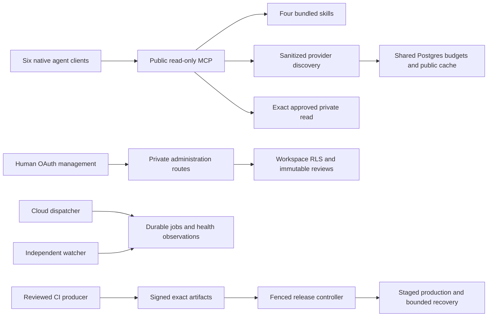

# Soren MCP project map

The repository extends the existing Next.js/Vercel application. The production endpoint remains `https://soren-shared-mcp-skills.vercel.app/api/mcp`, with alias `soren-skills` and MCP identity `soren-universal-skill-router`. GitHub source publication is separate from a production deployment.

## Runtime boundaries

The public gateway uses its own workspace-bound database role. It cannot call management or release RPCs. The private control plane validates managed identity, application resource, client ID, workspace membership and operation grants. Human review and owner actions also require recent authentication and matching browser Origin. Deployment-level secret confinement still requires verification; separate code adapters do not prove separate environment-variable exposure.

## Source ownership

| Path | Responsibility |
| --- | --- |
| `app/api/mcp/route.ts` | Stable eight-tool protocol, request limits, supplied identity checks, curated resources |
| `lib/catalog.mjs`, `skills/` | Bundled skills and deterministic approved routing |
| `lib/federation.mjs`, `lib/routing/` | Bounded allowlisted providers, sanitized queries, provisional/exact identities and routing evaluation |
| `lib/gateway.mjs` | Per-request identity context, shared quotas, public metadata cache and request/origin boundaries |
| `installer/`, `scripts/setup-agents.mjs` | Version-aware inspect/plan/apply/verify/remove/reconcile with exact local ownership |
| `lib/security/`, `lib/management-session.mjs`, `app/api/auth/` | Managed identity, grants, OAuth PKCE and encrypted short-lived management sessions |
| `lib/registry/`, `supabase/migrations/` | Canonical immutable versions, manifest-bound files, exact human reviews, catalog publication and revocation |
| `lib/operations/`, `app/api/cron/`, `app/api/health/` | Durable intents, database-time leases/fences, probes, stale evidence and deduplicated incidents |
| `lib/updates/`, `scripts/*release*.mjs` | Signed provenance, exact evidence/artifacts, staged delivery, reconciliation, probation and bounded rollback |
| `app/connect`, `registry`, `reviews`, `health`, `updates`, `manage` | Accessible public guidance and authenticated operational views |
| `.github/workflows/` | Unprivileged checks and separately gated trusted build/release/watch jobs |
| `docs/implementation/` | Original verified 25-file handoff, preserved without changing its initial NOT_RUN ledger |
| `docs/` | Current evidence, acceptance ledger, blockers and operator runbooks |

## Compatibility

The preserved public tools are `list_skills`, `search_skills`, `route_task`, `read_skill`, `list_providers`, `discover_skills`, `inspect_candidate`, and `search_mcp_servers`. Legacy array responses remain arrays. Bundled resource URIs remain `skill://<name>/SKILL.md`. MCP server tools remain read-only. New optional routing inputs and private version references do not authorize installation or review.

`auto` discovery is opt-in. Existing local and federated modes retain their meanings. External discovery can become unavailable when its shared store or quotas are unavailable; bundled local routes and reads remain usable. Provider candidates cannot inherit approval from a publisher, equal display name, scan result, or popularity.

## Delivery gates

Local tests, an installed tarball fixture, embedded Postgres, browser fixtures, native client invocation, staged cloud operation and production activation are distinct evidence scopes. The current ledger is `docs/acceptance-matrix.csv`; the handoff ledger is an unchanged source document. Missing hosted identity, multi-session database, real scheduler/watcher delivery, signing trust or owner release approval cannot be converted into a passing deployment claim.

No resident Windows router, startup item, desktop updater or new local scheduler is part of normal operation. Installer removal changes only unchanged owned entries. Updater mode starts at observe. Vercel's lack of verified atomic parent compare-and-swap blocks unattended promotion; manual exact-artifact owner authorization is separate.
